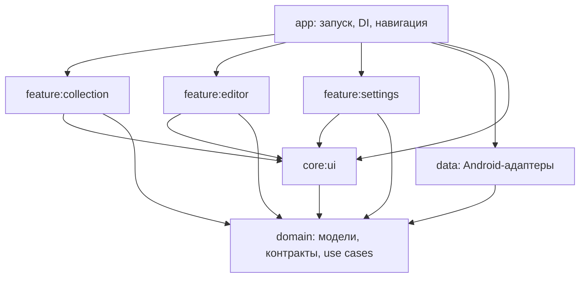

# Архитектура MyTop

Зависимости направлены к бизнес-правилам. `domain` — Kotlin/JVM-модуль без Android и библиотек хранения или UI. `app` — composition root: связывает реализации с контрактами через Koin и собирает навигацию.



## Модули

| Модуль | Ответственность |
| --- | --- |
| `app` | `MainApplication`, `MainActivity`, Koin composition root, `navigation/MyTopNavHost` |
| `domain` | Модели игр, поиск/сортировка/статистика, use cases, контракты репозиториев, политика экспорта, настройки и сценарий синхронизации |
| `data` | Room, мапперы сущностей, реализации репозиториев, SharedPreferences и DTO настроек, файловый обмен, JSON/TXT, заглушка серверного адаптера |
| `core:ui` | Тема Material 3, общие компоненты, строковые ресурсы, Android-локализация и адаптер подписей TXT |
| `feature:collection` | Список, поиск и фильтры, карточки/подробности, импорт/экспорт, ViewModel и UI-state |
| `feature:editor` | Добавление/редактирование, ViewModel, состояние формы и мапперы |
| `feature:settings` | Общие настройки, оформление и синхронизация, их ViewModel и UI-state |

## Правила слоёв

- UI не импортирует реализации из `data`. Экраны вызывают ViewModel; ViewModel обращается к use cases и контрактам `domain`.
- `data` не зависит от feature-модулей, Compose или ресурсов UI. Экспорт получает переведённые подписи через `TextExportStrings`; конкретный адаптер `LocalizedExportStrings` связывается в `app`.
- `domain` не знает о `Uri`, `Context`, Room, SharedPreferences, Android-ресурсах и сериализации. Идентификаторы документов передаются как строки; преобразование в Android URI происходит в адаптерах.
- Схемы JSON и SharedPreferences находятся в `data`. Сериализуемые DTO настроек преобразуются в чистые модели. Ключи SharedPreferences, имя БД `mytop.db`, таблица `games`, её версия и формат файлов сохранены.
- Feature-модули не зависят друг от друга. Переходы между ними задаются callback-функциями и собираются в навигации `app`.
- Не нужно создавать use case для каждого вызова ради дополнительной обёртки. Use cases выражают сценарии работы с играми и синхронизацию; контракты экспорта и настроек сами задают соответствующие операции.

## Проверки

```sh
bash gradlew verifyArchitecture :app:assembleDebug test lintDebug
```

`verifyArchitecture` проверяет разрешённые зависимости production-модулей и запрещённые импорты. Он также подключён к `:app:check`.

Тесты находятся рядом с ответственным слоем: правила запросов, обновления игр и статистики — в `domain`; кодеки и настройки хранения — в `data`; полнота переводов — в `core:ui`; состояние редактора и выборка экрана — в feature-модулях. Проверки feature-модулей, включающие реальное формирование файлов, используют `data` только в `testImplementation`. Production-зависимости от `data` у feature-модулей отсутствуют.

## Будущий сервер

`domain/sync/SyncGateway` — контракт серверного адаптера; `SyncClient` проверяет включение и адрес. `data/sync/UnconfiguredSyncGateway` пока возвращает недоступность сервера. Привязка интерфейса к реализации находится в `data/di/DataModule` и включается composition root приложения. Фоновая работа и реальный сетевой протокол не добавлены.
